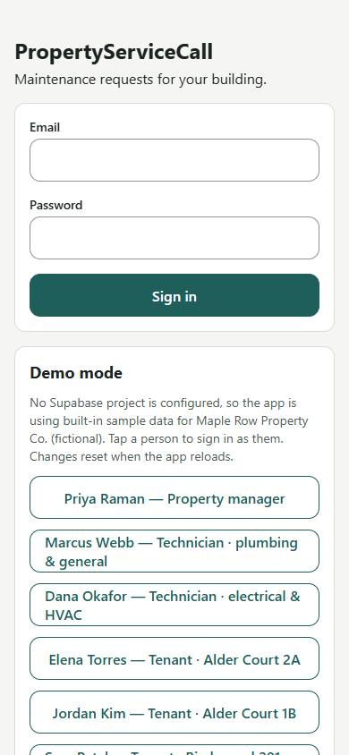
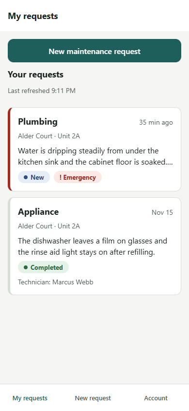
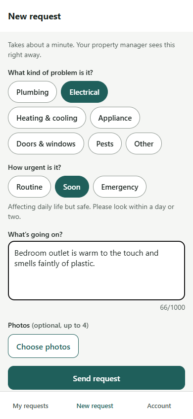
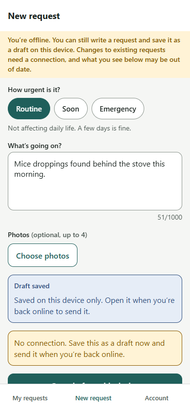
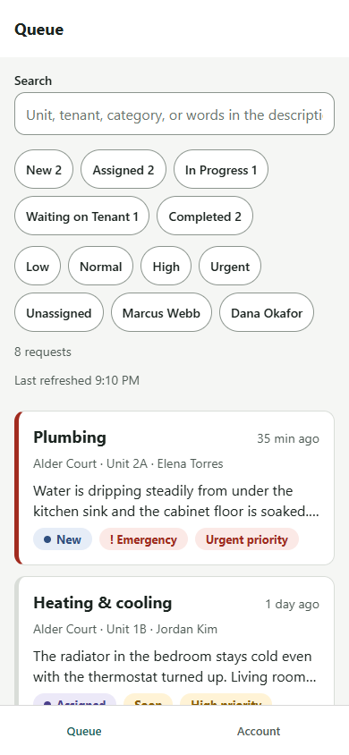
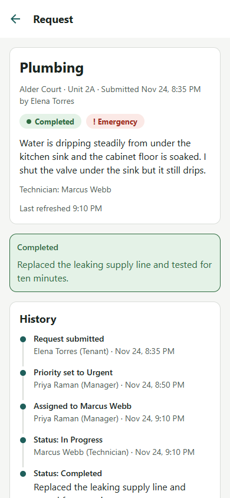

# PropertyServiceCall

A maintenance-request app for small residential properties. Tenants report problems, property managers triage and assign them, technicians do the work, and everyone sees a plain history of what happened.

Expo (SDK 58) · React Native · TypeScript · Expo Router · Supabase (Auth, Postgres, Storage).

## Screenshots

Captured from the web build in demo mode at phone width.

| Sign in (demo people) | Tenant: my requests | New request |
|---|---|---|
|  |  |  |

| Offline draft | Manager queue | Request history |
|---|---|---|
|  |  |  |

## Quick start (no backend needed)

```bash
npm install
npm start          # then press w for web, or scan the QR code with Expo Go
```

With no Supabase credentials the app runs in **demo mode** on built-in sample data for a fictional company, Maple Row Property Co. The sign-in screen lists the sample people; tap one to sign in as them. Demo data lives in memory and resets when the app reloads. See [docs/DEMO.md](docs/DEMO.md) for a role-by-role walkthrough.

> **Node version:** Expo SDK 58's CLI requires **Node 22.13+**. On older Node, `npm start` fails with `URL.parse is not a function`. `npx expo export --platform web` and `npm test` still work on Node 20.

## Connect a real Supabase project

1. Create a project at [supabase.com](https://supabase.com).
2. In the SQL editor, run these in order:
   `supabase/migrations/0001_schema.sql` → `0002_rls.sql` → `0003_storage.sql` → `0004_rpc.sql`
   (or `supabase db push` with the Supabase CLI).
3. Create the seven demo users in **Authentication → Users → Add user** (tick *Auto Confirm User*), using the emails and password listed at the top of `supabase/seed.sql`, then run `supabase/seed.sql`. Skip this and create your own organization, units and memberships if you are not demoing.
4. Copy `.env.example` to `.env` and fill in:

   | Variable | Value |
   |---|---|
   | `EXPO_PUBLIC_SUPABASE_URL` | Project URL (Settings → API) |
   | `EXPO_PUBLIC_SUPABASE_ANON_KEY` | The **anon / publishable** key |

   **Never put the service-role key in this app or in any `EXPO_PUBLIC_*` variable.** Everything in `EXPO_PUBLIC_*` is shipped inside the app bundle.
5. Restart with `npx expo start -c`. The "Demo mode" card disappears when credentials are present.

### Adding real people
Clients cannot create memberships (that would let anyone grant themselves manager). Add them as an admin, in the SQL editor:

```sql
insert into memberships (org_id, user_id, role, unit_id)
values ('<org>', '<auth user id>', 'tenant', '<unit id>');   -- tenant: one row per unit
insert into memberships (org_id, user_id, role) values ('<org>', '<auth user id>', 'technician');
```

## Scripts

| Command | What it does |
|---|---|
| `npm start` | Start the Expo dev server |
| `npm test` | Jest unit and flow tests |
| `npm run typecheck` | `tsc --noEmit` |
| `npx eslint src tests` | Lint |
| `npx expo export --platform web` | Production web bundle into `dist/` (a quick build check) |

## What works offline, honestly

| Works offline | Needs a connection |
|---|---|
| Writing a request and **saving it as a draft on the device** (text, category, urgency, photo references) | Sending a request |
| Re-opening and editing drafts | Everything else: viewing fresh data, status changes, assignment, notes, photo upload |
| Seeing the **last loaded** lists and request details for this session, clearly labelled "Last refreshed hh:mm" | |

Lists are cached in memory only and are not persisted between app launches. Drafts are persisted (AsyncStorage) and are tied to the account that wrote them. Failed sends keep the draft, show the reason, and offer **Retry**. Sending is idempotent (the draft id is the `client_request_id`), so a retry after a lost response does not create a duplicate. If the request is created but a photo upload fails, only the failed photos are kept for retry.

Photos chosen for a draft are referenced by their temporary file location. The OS can clear that cache, so a very old draft may need its photos re-attached.

## Project layout

```
src/app/            Expo Router routes: thin screens only
  sign-in.tsx
  (app)/(tabs)/     role-aware tabs (My requests / Queue / My work, New request, Account)
  (app)/request/[id], (app)/edit/[id]   pushed over the tabs
src/domain/         Pure business rules: statuses, transitions, validation, filters, labels
src/data/           Repository interface, Supabase + demo implementations, error mapping
src/features/       auth, requests (hooks + screens), drafts (store + submit logic)
src/components/     Shared UI: buttons, fields, badges, states, dialog, timeline, photos
src/state/          Local UI state only (connectivity, filters)
src/theme/          Colour, spacing and touch-target tokens
supabase/           migrations/0001-0004 + seed.sql
tests/              Jest tests
docs/               ARCHITECTURE.md, DEMO.md
```

Architecture and security decisions: [docs/ARCHITECTURE.md](docs/ARCHITECTURE.md).
